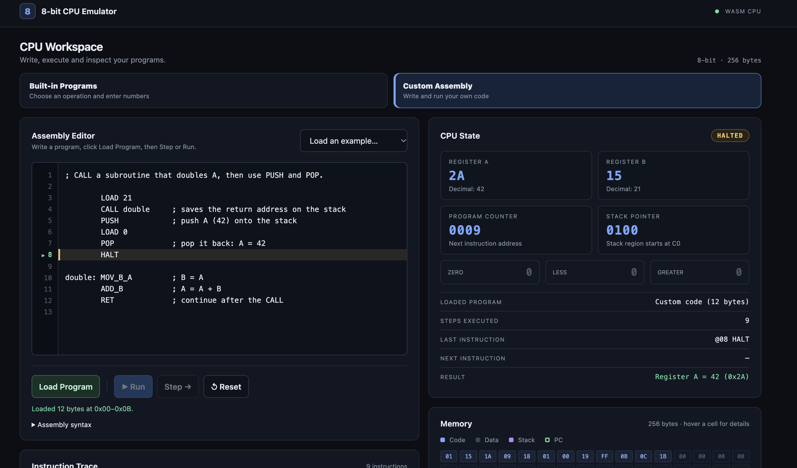
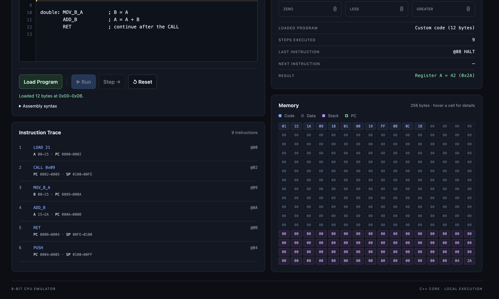

# 8-Bit CPU Emulator

A small 8-bit CPU emulator written in C++17. It simulates a CPU with two general-purpose registers, comparison flags, 256 bytes of memory, a hardware-style stack, and subroutine calls. You can run it from the command line or in the browser, where the same C++ CPU runs as WebAssembly: pick a built-in program, enter its inputs, and watch it execute one instruction at a time or all at once.

This is a learning project about CPU architecture, the fetch–decode–execute cycle, and testing low-level code.

## Live Demo

**[8bit-cpu-emulator.vercel.app](https://8bit-cpu-emulator.vercel.app)**

The demo runs entirely in your browser. The C++ CPU is compiled to WebAssembly, so no server or installation is needed.

## Screenshots

### CPU Workspace and Assembly Editor



### Instruction Trace and Memory



## Features

- **28 instructions** covering data movement, arithmetic, bitwise logic, shifts, comparisons, conditional and unconditional jumps, stack operations, and subroutine calls
- **Two 8-bit registers** (`A` and `B`), a 16-bit program counter, and a stack pointer
- **Three status flags**: zero, less, and greater
- **256 bytes of memory**, split into a program/data region and a stack region
- **Stack support** with `PUSH`, `POP`, `CALL`, and `RET`, including overflow and underflow detection
- **Two execution modes**: step mode (one instruction per Enter key press) and run mode (runs until `HALT`)
- **CPU state output** after every instruction: registers, program counter, flags, and halt status
- **Memory inspection**: read a single address, or dump a range of addresses in hex and decimal
- **Input validation** for every prompt, with clean exit on end of input (EOF)
- **Browser dashboard**: the C++ CPU compiled to WebAssembly, showing registers, flags, all 256 bytes of memory, and an instruction trace. It is a static site with no backend, so it can be deployed to Vercel
- **Assembly Editor**: write your own assembly programs in the browser. A C++ assembler turns them into machine code and runs them on the same CPU, highlighting the line being executed
- **Unit and integration tests**, plus one script that builds and runs them all

## Instruction Set

Each opcode is one byte. Instructions that take an operand read one extra byte right after the opcode.

| Opcode | Mnemonic   | Operand | Description                                             |
| -----: | ---------- | ------- | ------------------------------------------------------- |
|      1 | `LOAD`     | value   | Load an immediate value into register A                 |
|      2 | `ADD`      | value   | Add an immediate value to register A                    |
|      3 | `SUB`      | value   | Subtract an immediate value from register A             |
|      4 | `JMP`      | address | Jump to address unconditionally                         |
|      5 | `JZ`       | address | Jump if register A is zero                              |
|      6 | `LOAD_MEM` | address | Load the byte at a memory address into register A       |
|      7 | `STORE`    | address | Store register A at a memory address                    |
|      8 | `LOAD_B`   | value   | Load an immediate value into register B                 |
|      9 | `STORE_B`  | address | Store register B at a memory address                    |
|     10 | `MOV_A_B`  | —       | Copy register B into register A                         |
|     11 | `MOV_B_A`  | —       | Copy register A into register B                         |
|     12 | `ADD_B`    | —       | Add register B to register A                            |
|     13 | `SUB_B`    | —       | Subtract register B from register A                     |
|     14 | `CMP`      | —       | Compare A with B and set the zero, less, and greater flags |
|     15 | `JE`       | address | Jump if the zero flag is set (equal)                    |
|     16 | `JL`       | address | Jump if the less flag is set (A < B)                    |
|     17 | `JG`       | address | Jump if the greater flag is set (A > B)                 |
|     18 | `AND`      | —       | A = A AND B                                             |
|     19 | `OR`       | —       | A = A OR B                                              |
|     20 | `XOR`      | —       | A = A XOR B                                             |
|     21 | `NOT`      | —       | A = NOT A                                               |
|     22 | `SHL`      | —       | Shift register A left by one bit                        |
|     23 | `SHR`      | —       | Shift register A right by one bit                       |
|     24 | `PUSH`     | —       | Push register A onto the stack                          |
|     25 | `POP`      | —       | Pop the top of the stack into register A                |
|     26 | `CALL`     | address | Push the return address and jump to a subroutine        |
|     27 | `RET`      | —       | Return from a subroutine                                |
|    255 | `HALT`     | —       | Stop execution                                          |

Opcode values are defined as constants in the `CPU` class in [`src/cpu.h`](src/cpu.h). Their names, used for the execution trace, are in [`src/instruction_names.h`](src/instruction_names.h).

## Project Structure

```text
8bit-cpu-emulator/
├── .gitignore
├── README.md
├── vercel.json                 # Vercel static deployment settings (serves web/)
├── run_all_tests.sh            # Entry point: runs scripts/run_all_tests.sh
├── src/
│   ├── cpu.h                   # CPU class: registers, flags, memory, stack, instruction execution
│   ├── program_loader.h        # load_program(): copies a program into memory
│   ├── instruction_names.h     # Maps opcodes to mnemonics for the execution trace
│   ├── programs.h              # The nine built-in programs used by the web interface
│   ├── emulator_session.h      # CPU session with trace and JSON state, shared by WASM and the server
│   ├── assembler.h             # Two-pass assembler: assembly source -> machine code
│   ├── wasm_api.cpp            # C interface compiled to WebAssembly for the browser
│   ├── main.cpp                # Interactive emulator: program menu, execution modes, memory inspection
│   └── web_server.cpp          # Optional local HTTP server and JSON API (not needed by the browser app)
├── web/                        # Static site root (deployed to Vercel)
│   ├── index.html              # Dashboard layout
│   ├── style.css               # Dashboard styles
│   ├── app.js                  # Connects the dashboard and the Assembly Editor to the WebAssembly CPU
│   ├── examples.js             # Example programs for the Assembly Editor
│   └── generated/              # Built by scripts/build_wasm.sh and committed
│       ├── cpu.js              # Emscripten loader (defines createCpuModule)
│       └── cpu.wasm            # The C++ CPU compiled to WebAssembly
├── tests/
│   ├── test_cpu.cpp            # Unit tests for the CPU, loader, and instruction names
│   ├── test_main.sh            # Integration tests for the interactive emulator
│   ├── test_web_session.cpp    # Unit tests for the CPU session (native and WebAssembly)
│   ├── test_assembler.cpp      # Assembler tests that run the assembled code on the CPU
│   ├── test_web_server.py      # HTTP integration tests for the web server
│   ├── test_wasm.mjs           # Tests the WebAssembly interface in Node
│   └── test_frontend.mjs       # Drives the static site in headless Chrome
├── scripts/
│   ├── build_wasm.sh           # Builds web/generated/ with Emscripten
│   ├── run_all_tests.sh        # Builds everything and runs all tests
│   └── run_test.py             # Runs build/cpu_emulator with piped input and a 3-second timeout
├── screenshots/                # Images used in this README
└── build/                      # Compiled programs (created by the build, not tracked by Git)
```

## Requirements

- A C++17 compiler. The build scripts use `clang++`; `g++` with `-std=c++17` should also work.
- Bash, to run the test scripts.
- Python 3, used by the integration tests to run the emulator with a timeout.
- [Emscripten](https://emscripten.org), only to rebuild the WebAssembly module. On macOS: `brew install emscripten`, then check with `emcc --version`.
- Node.js and Google Chrome, for the WebAssembly and browser tests.

The C++ code uses only the standard library. There is no build system and there are no npm packages.

## Build and Run

Run all commands from the project root. Compiled programs go into `build/`.

### Terminal emulator

```bash
mkdir -p build
clang++ -std=c++17 src/main.cpp -o build/cpu_emulator
./build/cpu_emulator
```

### Web interface (WebAssembly)

The browser app runs the C++ CPU as WebAssembly, so it only needs a static file server. Build the module (only needed after changing C++ code, because `web/generated/` is committed):

```bash
./scripts/build_wasm.sh
```

Serve `web/` and open <http://127.0.0.1:8080>:

```bash
python3 -m http.server 8080 --bind 127.0.0.1 --directory web
```

Opening `web/index.html` directly as a file does not work, because browsers do not load WebAssembly from `file://` URLs.

The C++ server also serves the same site: `clang++ -std=c++17 -Wall -Wextra src/web_server.cpp -o build/web_server && ./build/web_server`. It still provides the JSON API under `/api/`, but the browser app no longer uses it.

### How the browser talks to the CPU

`web/app.js` loads `generated/cpu.js`, which loads `cpu.wasm`. It calls the functions in `src/wasm_api.cpp` with `ccall`: `cpu_programs`, `cpu_state`, `cpu_load(program, a, b)`, `cpu_load_assembly(source)`, `cpu_step`, `cpu_run`, `cpu_reset`, and `cpu_memory_byte(address)`. Each returns JSON in the same format as the HTTP API, `{"ok":true,"state":{...}}` or `{"ok":false,"error":"..."}`. The state includes registers, flags, all 256 memory bytes, the next instruction, and the trace. Instruction execution happens only in C++ (`src/cpu.h`); JavaScript only displays the state.

### Deploy to Vercel

`vercel.json` tells Vercel to publish `web/` as a static site. Vercel cannot run Emscripten, so it deploys the committed files in `web/generated/`. The build command only checks that they exist.

1. Rebuild and test: `./run_all_tests.sh`, which also rebuilds `web/generated/`.
2. Commit, including `web/generated/cpu.js`, `web/generated/cpu.wasm`, and `vercel.json`, and push to GitHub.
3. In Vercel, choose **Add New → Project**, import the repository, and keep the settings from `vercel.json` (Framework Preset: Other, Output Directory: `web`). Click **Deploy**.

Without GitHub, deploy from the project root with the Vercel CLI: `npx vercel` for a preview, then `npx vercel --prod`.

## Usage

The emulator is interactive and guides you through each step.

### 1. Choose a program

```text
=== 8-Bit CPU Emulator ===
Choose a program:
1 - Comparison
2 - Addition
3 - Subtraction
4 - Bitwise AND
5 - Bitwise OR
6 - Bitwise XOR
7 - Bitwise NOT
8 - Shift Left (SHL)
9 - Shift Right (SHR)
```

### 2. Enter input values

Each value must be an integer from 0 to 255.

- Programs **1–6** ask for two numbers. The first is loaded into register A and the second into register B.
- Programs **7–9** ask for one number, which is loaded into register A.

Invalid or out-of-range input shows an error and asks again.

### 3. Choose an execution mode

- `s` — **Step mode**: runs one instruction, prints the CPU state, and waits for Enter before the next one.
- `r` — **Run mode**: runs every instruction until `HALT`, printing the CPU state after each one.

Both modes print each instruction before running it, for example:

```text
Executing: ADD_B (address 4)
Register A: 15
Register B: 5
Program Counter: 5
Zero flag: false
Less flag: false
Greater flag: false
CPU halted: no
------------------------
```

### 4. Inspect memory (optional)

After the program halts, you can:

1. Read a single address (0–255). Its value is shown in decimal and hex.
2. Dump a range of memory by giving a start address and a byte count. The range must stay inside the 256-byte memory.

```text
Memory Dump
Address   Hex   Decimal
-----------------------
0x00      01      1
0x01      0A     10
```

### 5. See the result

The emulator prints the final value of register A. For the comparison program, register A holds a result code:

| Register A | Meaning |
| ---------: | ------- |
|          1 | A < B   |
|          2 | A > B   |
|          3 | A == B  |

You can then run another program (`y`), which resets the CPU first, or exit (`n`). If input ends (EOF), the emulator exits.

## Assembly Editor

The web dashboard has two modes, chosen with the tabs at the top:

- **Built-in Programs**: choose one of the nine programs, enter Input A (and Input B when the program uses it), and use Run, Step, or Reset.
- **Custom Assembly**: the **Assembly Editor**, for writing your own programs. Choosing **Custom (Assembly Editor)** in the program menu opens the same mode. Your programs run on the same C++ CPU (compiled to WebAssembly) as the built-in programs.

In both modes, the **CPU State** panel on the right shows:

- the registers and flags;
- the status (`READY`, `RUNNING`, `HALTED`, or `ERROR`);
- the loaded program;
- the number of executed instructions;
- the last and next instruction;
- the result.

The memory viewer is below it. The instruction trace is directly below the program panel or editor. On narrow screens, the sections are stacked in this order: program, CPU State and memory, then the trace.

To use the editor:

1. Open the **Custom Assembly** tab. The code in the editor is loaded straight away. Write your own code, or pick one under **Load an example…**.
2. Click **Load Program** (below the editor, next to Run, Step, and Reset). The C++ assembler (`src/assembler.h`) turns the code into machine code. The CPU is then reset and the bytes are loaded into memory from address `0x00`.
3. Use **Step** or **Run**. The registers, flags, memory, and trace update as with the built-in programs. The editor highlights the line of the next instruction (green), the last instruction after `HALT` (amber), or the instruction that caused a CPU error (red).
4. **Reset** restarts your program from the beginning with its original memory.

If assembly fails, the errors are listed below the editor with their line numbers, and the line numbers are marked red. Click an error to jump to its line. The program that was loaded before stays loaded, and nothing in the CPU changes. **Loaded program** in the CPU State panel shows which program that is. Run and Step do not run it while the editor has errors; they show the errors again. If you edit the code after loading it, the editor tells you to click **Load Program** again.

### Syntax

```asm
; Count down from 5 to 1 and store each value at address 0xB0.

        LOAD 5          ; A = 5
loop:   STORE 0xB0      ; memory[0xB0] = A
        SUB 1           ; A = A - 1
        JZ done         ; JZ jumps when A is 0
        JMP loop        ; otherwise repeat
done:   HALT
```

- **One statement per line**: an instruction (`MNEMONIC operand`), a `.byte` directive, a label, or nothing.
- **Comments** start with `;` and run to the end of the line.
- **Labels** are written as `name:`, either on their own line or before a statement. Names use letters, digits, and `_` and cannot start with a digit. A label marks the address of the next statement. It cannot have the same name as an instruction or be defined twice.
- **Case**: mnemonics, labels, and `.byte` are not case-sensitive. `load`, `LOAD`, and `Load` are the same instruction, and `Loop` and `loop` are the same label.
- **Numbers** go from 0 to 255 and can be decimal (`42`), hexadecimal (`0x2A`), or binary (`0b101010`). Negative numbers are not supported. To subtract, use `SUB` (for example, `SUB 1`).
- **Operands**: each instruction takes either one operand or none, separated by spaces (no commas):

  | Operand | Instructions | Accepts |
  | --- | --- | --- |
  | value | `LOAD`, `LOAD_B`, `ADD`, `SUB` | a number 0–255 |
  | code address | `JMP`, `JZ`, `JE`, `JL`, `JG`, `CALL` | a label, or the number of an address where an instruction or `.byte` data starts in the program |
  | read address | `LOAD_MEM` | a label or any address 0–255 (the stack can be read) |
  | write address | `STORE`, `STORE_B` | a label or an address 0–191 (`0x00`–`0xBF`) |
  | none | `MOV_A_B`, `MOV_B_A`, `ADD_B`, `SUB_B`, `CMP`, `AND`, `OR`, `XOR`, `NOT`, `SHL`, `SHR`, `PUSH`, `POP`, `RET`, `HALT` | — |

- **Data**: `.byte 1, 2, 3` places raw bytes in the program, separated by commas or spaces. With a label (`count: .byte 0`), the data can be used as a variable through `LOAD_MEM count` and `STORE count`.

### How the CPU behaves

These rules come from `src/cpu.h`, and the assembler does not change them:

- `MOV_A_B` copies B into A (A ← B). `MOV_B_A` copies A into B (B ← A).
- `JZ` jumps when register **A is 0**, whatever the flags say. `JE`, `JL`, and `JG` jump on the Zero, Less, and Greater flags.
- `CMP` sets all three flags. `ADD`, `SUB`, `ADD_B`, `SUB_B`, `AND`, `OR`, `XOR`, `NOT`, `SHL`, `SHR`, and `POP` set only the Zero flag (from the new value of A), so `JE` after them means "A is 0". `LOAD`, `LOAD_B`, `LOAD_MEM`, and the `MOV` instructions do not change any flags.
- Arithmetic wraps around in 8 bits (`250 + 10 = 4`, `5 - 7 = 254`).
- `CALL` stores the 2-byte return address on the stack and `RET` takes it back. `POP` cannot take a value that `CALL` pushed.
- The program starts at address `0x00`. Code and data can use at most 192 bytes (`0x00`–`0xBF`). Addresses `0xC0`–`0xFF` are reserved for the stack.

### What the assembler checks

The assembler rejects:

- unknown instructions;
- missing, extra, or comma-separated operands;
- invalid numbers and numbers outside 0–255;
- labels used as values (for example `LOAD label`);
- undefined, duplicate, or invalid labels;
- jumps outside the program or into the middle of an instruction;
- `STORE` or `STORE_B` into the stack region;
- empty programs and programs larger than 192 bytes.

It reports all errors at once, sorted by line. A program without `HALT` loads with a warning, because it can only end with a CPU error.

These problems are found by the CPU while the program runs, as they are for the built-in programs:

- stack overflow and underflow;
- `RET` without a matching `CALL`;
- running into an invalid opcode (for example, past the end of the program);
- running for more than 1,000 instructions with **Run**.

The examples in the editor are a loop, multiplication with data variables, a comparison, and a subroutine with the stack.

## Testing

### Run all tests

```bash
./run_all_tests.sh
```

This script:

1. Builds `build/cpu_emulator` from `src/main.cpp`
2. Builds and runs the unit tests in `tests/test_cpu.cpp`
3. Runs the integration tests in `tests/test_main.sh`
4. Builds `build/web_server` from `src/web_server.cpp`
5. Builds and runs the web session unit tests in `tests/test_web_session.cpp`
6. Builds and runs the assembler tests in `tests/test_assembler.cpp`
7. Rebuilds `web/generated/` and runs `tests/test_cpu.cpp`, `tests/test_web_session.cpp`, and `tests/test_assembler.cpp` compiled to WebAssembly in Node. Without Emscripten, it prints `SKIPPED` for these steps and tests the committed module instead
8. Runs the web server integration tests in `tests/test_web_server.py`
9. Runs the WebAssembly interface tests in `tests/test_wasm.mjs`
10. Runs the browser tests in `tests/test_frontend.mjs`

It can be called from any directory.

It stops at the first failure.

### Unit tests

[`tests/test_cpu.cpp`](tests/test_cpu.cpp) tests the `CPU` class directly. It covers:

- Every instruction, including how each one affects registers and flags
- 8-bit wraparound on addition, subtraction, and left shift
- Conditional jumps when taken and not taken, and rejection of jump targets outside program memory
- Stack behavior: `PUSH`/`POP` order, overflow, underflow, nested `CALL`/`RET`, `RET` without `CALL`, and preventing `POP` from consuming a return address
- Memory protection: `STORE` and `STORE_B` cannot write into the stack region
- Error cases: unknown opcodes, an operand that would fall past the end of program memory, out-of-range reads, and runaway loops
- `reset()`, the `load_program()` size limit, and the mnemonic for every opcode

Build and run them on their own:

```bash
mkdir -p build
clang++ -std=c++17 tests/test_cpu.cpp -o build/test_cpu
./build/test_cpu
```

Each check prints `PASS: ...`. On the first failure, the program prints `FAIL: ...` and exits with a non-zero status.

### Integration tests

[`tests/test_main.sh`](tests/test_main.sh) tests the interactive emulator end to end. Each test pipes scripted input through [`scripts/run_test.py`](scripts/run_test.py), which runs `build/cpu_emulator` with a 3-second timeout. The test then checks both the output and the exit code. The tests cover:

- Invalid program choice and invalid number input
- EOF while waiting for the first or second number
- Correct final results for addition, subtraction, AND, OR, XOR, NOT, SHL, and SHR

The emulator must be built first:

```bash
mkdir -p build
clang++ -std=c++17 src/main.cpp -o build/cpu_emulator
./tests/test_main.sh
```

### Web tests

- [`tests/test_web_session.cpp`](tests/test_web_session.cpp) tests the CPU session directly: the 1,000-instruction limit for runaway programs, CPU faults, reset, and comparison results.
- [`tests/test_assembler.cpp`](tests/test_assembler.cpp) assembles programs and runs them on the CPU. It checks the encoding of every kind of operand, that the comparison program written in assembly produces exactly the bytes of the built-in one, loops, labels, comments, data, `CALL`/`RET`, every error message with its line number, the 192-byte limit, and that the CPU's own errors and instruction limit still apply.
- [`tests/test_wasm.mjs`](tests/test_wasm.mjs) loads `web/generated/cpu.js` in Node. It checks that all nine programs give the same result as `build/cpu_emulator`, that Step runs one instruction, that Run stops at `HALT`, that Reset restores registers and memory, that all 256 memory bytes are readable, and that invalid inputs are rejected. For `cpu_load_assembly`, it checks error reporting, that a failed assembly leaves the CPU unchanged, the source map, and Step, Run, and Reset with custom code.
- [`tests/test_frontend.mjs`](tests/test_frontend.mjs) serves `web/` with a plain static server and clicks through the dashboard in headless Chrome. It checks Run, Step, Reset, program changes, input errors, and all nine programs. For the Assembly Editor, it checks every example, Step with the line highlight, memory and trace updates, Reset, error messages and gutter marks, that a failed Load Program keeps the old program, and CPU errors in custom code. It also fails on any console error, failed request, or request to `/api/`, and checks the error shown when `cpu.js` or `cpu.wasm` is missing.
- [`tests/test_web_server.py`](tests/test_web_server.py) builds and starts `build/web_server` on port 18080 and tests the API over HTTP. It checks that all nine programs give the same result as `build/cpu_emulator`, and covers step and trace data, input validation, malformed requests, local-only access, and missing web files.

```bash
mkdir -p build
clang++ -std=c++17 src/main.cpp -o build/cpu_emulator
clang++ -std=c++17 -Wall -Wextra tests/test_web_session.cpp -o build/test_web_session
./build/test_web_session
clang++ -std=c++17 -Wall -Wextra tests/test_assembler.cpp -o build/test_assembler
./build/test_assembler
python3 tests/test_web_server.py
node tests/test_wasm.mjs
node tests/test_frontend.mjs
```

## Technical Details

### Memory layout

Memory is 256 bytes, addressed from `0x00` to `0xFF`:

| Range                | Size     | Purpose                    |
| -------------------- | -------- | -------------------------- |
| `0x00`–`0xBF` (0–191)   | 192 bytes | Program code and data |
| `0xC0`–`0xFF` (192–255) | 64 bytes  | Stack                 |

- Programs are loaded starting at address 0. `load_program()` rejects programs longer than 192 bytes.
- Any address can be read. `STORE` and `STORE_B` can only write to the program/data region.
- The program counter and all jump and call targets must stay inside the program/data region.

### Registers

| Register          | Width  | Description                                |
| ----------------- | ------ | ------------------------------------------ |
| A                 | 8-bit  | Accumulator. Holds the result of arithmetic, logic, and shift operations |
| B                 | 8-bit  | Second operand for register-based instructions |
| Program counter   | 16-bit | Address of the next byte to fetch          |
| Stack pointer     | 16-bit | Starts at 256 and moves down as values are pushed |

Arithmetic and shifts wrap around modulo 256. For example, `255 + 1` gives `0`, and `0 - 1` gives `255`.

### Flags

| Flag    | Set by                                              |
| ------- | --------------------------------------------------- |
| Zero    | `ADD`, `SUB`, `ADD_B`, `SUB_B`, `AND`, `OR`, `XOR`, `NOT`, `SHL`, `SHR`, and `POP` (result is 0); `CMP` (A == B) |
| Less    | `CMP` only (A < B)                                  |
| Greater | `CMP` only (A > B)                                  |

Load and move instructions do not change any flags. `JE` checks the zero flag, while `JZ` checks register A directly.

### Stack

- The stack grows downward from the top of memory into the 64-byte stack region.
- `PUSH` stores register A at the next lower address. `POP` reads it back and updates the zero flag.
- `CALL` pushes a 2-byte return address (low byte first) and jumps to the target. `RET` pops it and continues from there.
- The CPU keeps track of where each return address is stored. `RET` fails if the top of the stack is not a return address (for example, after an unmatched `PUSH`), and `POP` cannot read a return address.

### Error handling

Invalid operations throw C++ exceptions (`std::runtime_error` or `std::out_of_range`) instead of failing silently. These include:

- Unknown opcodes
- Writing outside the allowed memory region
- Reading past the end of memory
- The program counter, or a jump or call target, leaving the program/data region
- Stack overflow and stack underflow
- Loading a program larger than 192 bytes
- Going over 1,000 instructions in `CPU::run()`, which catches infinite loops

The interactive emulator in `src/main.cpp` runs the CPU with its own `step()` loop rather than `CPU::run()`, so the 1,000-instruction limit applies only when `run()` is called directly, as in the unit tests.
